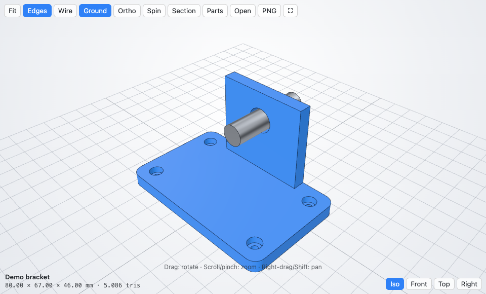
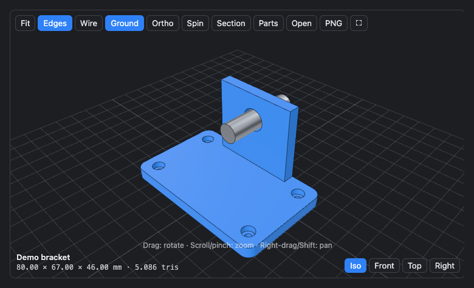
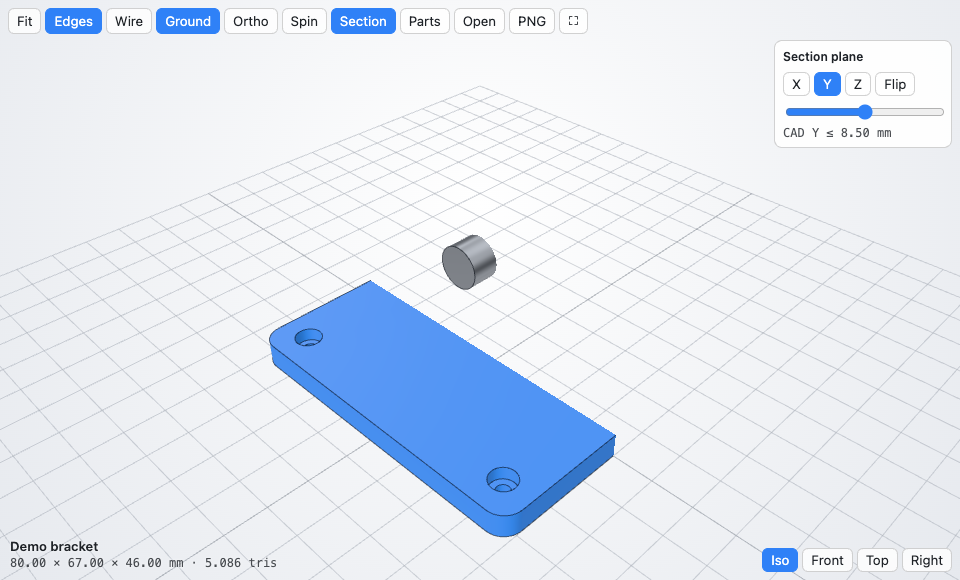
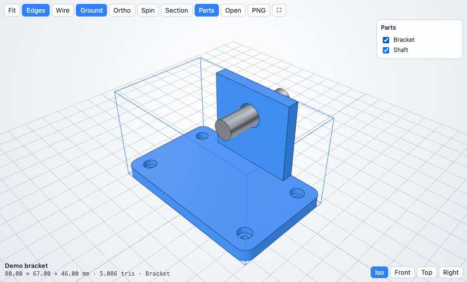

# SolidCraft Model Viewer (Agent Skill & CLI)

[](https://github.com/gh-patrickr/skills/actions/workflows/validate.yml)
[](LICENSE)

Pack any **SolidCraft** (`.sc`), **STEP** (`.step`/`.stp`), **glTF** (`.glb`/`.gltf`), or **STL** (`.stl`) 3D model into a **single, self-contained, offline HTML file** that anyone can rotate, zoom, pan, and inspect in a browser or inline inside **Antigravity** chat — with zero CDN requests, zero servers, and zero Python dependencies.



| Dark theme / inline chat embed | Interactive CAD section plane (mm) | Parts inspector & picking |
| :---: | :---: | :---: |
|  |  |  |

## Features

- **One self-contained HTML file** — [Three.js](https://threejs.org/) r187 is minified and inlined (~665 KiB). Works offline, by double-clicking from `file://`, on static sites, and inside CSP-restricted HTML artifacts such as Antigravity `<agent-embed>`.
- **CAD-friendly navigation** — Left-drag orbit, scroll/pinch zoom-to-cursor, right-drag / Shift-drag pan, double-click to fit.
- **SolidCraft standard views** — **Iso / Front / Top / Right** buttons (plus Back / Left / Bottom via keys `1`–`7`) aligned to SolidCraft's CAD axes (Front from `-Y`, Top from `+Z`, Right from `+X`).
- **Inspection tools** — Crisp 28° feature edges (`E`), wireframe (`W`), orthographic vs. perspective toggle (`O`), ground grid + contact shadow (`G`), auto-rotate (`R`), CAD X/Y/Z section plane with mm readout and flip (`S`), multi-body parts toggle & click-to-highlight (`P`), overall mm bounding-box + triangle count, and transparent PNG screenshot export.
- **Host theme sync** — Automatically adapts to light/dark themes (`prefers-color-scheme` and host CSS theme tokens).
- **Flexible loading** — Embedded base64 GLB/STL by default (`sc_view.py`), plus optional `--link` / `?model=` URL mode for web servers and drag-and-drop / **Open** button for ad-hoc viewing.

---

## Install

### Option 1: One-command install via `npx skills` (Antigravity, Claude Code, Codex, Cursor, …)

```bash
npx skills add gh-patrickr/skills --skill solidcraft-model-viewer
```

Add `-g` to install globally across all workspaces:

```bash
npx skills add gh-patrickr/skills --skill solidcraft-model-viewer -g
```

### Option 2: One-command shell installer (no Node.js required)

Downloads only the `solidcraft-model-viewer` skill from GitHub using `curl` and `tar`:

```bash
# Auto-detects Antigravity (~/.gemini/config/skills) or falls back to ~/.agents/skills:
curl -fsSL https://raw.githubusercontent.com/gh-patrickr/skills/main/solidcraft-model-viewer/scripts/install.sh | bash
```

Or target specific agent directories (flags can be combined):

```bash
# Antigravity (global)
curl -fsSL https://raw.githubusercontent.com/gh-patrickr/skills/main/solidcraft-model-viewer/scripts/install.sh | bash -s -- --antigravity

# Claude Code (global)
curl -fsSL https://raw.githubusercontent.com/gh-patrickr/skills/main/solidcraft-model-viewer/scripts/install.sh | bash -s -- --claude

# OpenAI Codex (global)
curl -fsSL https://raw.githubusercontent.com/gh-patrickr/skills/main/solidcraft-model-viewer/scripts/install.sh | bash -s -- --codex

# Current workspace only (./.agents/skills/solidcraft-model-viewer)
curl -fsSL https://raw.githubusercontent.com/gh-patrickr/skills/main/solidcraft-model-viewer/scripts/install.sh | bash -s -- --project

# Custom directory
curl -fsSL https://raw.githubusercontent.com/gh-patrickr/skills/main/solidcraft-model-viewer/scripts/install.sh | bash -s -- --dir /path/to/skills/solidcraft-model-viewer
```

### Option 3: Sparse `git clone` (inspect before running)

```bash
git clone --filter=blob:none --sparse https://github.com/gh-patrickr/skills.git /tmp/sc-skills
cd /tmp/sc-skills && git sparse-checkout set solidcraft-model-viewer
bash solidcraft-model-viewer/scripts/install.sh --from ./solidcraft-model-viewer --antigravity
```

---

## Quick Start

Packing models requires **only Python 3.9+** (standard library only; no `pip` or `npm` install). Converting `.sc` or `.step` files directly also uses `solidcraft-cli` on your `PATH`.

Try it on the included demo model:

```bash
# Replace SKILL_DIR with where you installed it (e.g. ~/.gemini/config/skills/solidcraft-model-viewer)
python3 "$SKILL_DIR/scripts/sc_view.py" "$SKILL_DIR/examples/demo-bracket.glb" -o demo-bracket.html --title "Demo bracket"
open demo-bracket.html   # macOS (or xdg-open on Linux)
```

Pack your own models:

```bash
# From a SolidCraft design (.sc) or STEP file (auto-exports GLB via solidcraft-cli):
python3 "$SKILL_DIR/scripts/sc_view.py" bracket.sc -o bracket.html --title "Mounting Bracket v2"

# Keep the exported GLB next to the HTML:
python3 "$SKILL_DIR/scripts/sc_view.py" bracket.sc --glb-out bracket.glb -o bracket.html

# From an existing .glb, .gltf, or .stl:
python3 "$SKILL_DIR/scripts/sc_view.py" housing.glb -o housing.html --view front --spin

# Reference-only mode for static web servers (does not embed base64; requires http/https):
python3 "$SKILL_DIR/scripts/sc_view.py" housing.glb -o site/housing.html --link
```

### Embedded vs. Linked Mode

| Loading method | Double-click (`file://`) | Antigravity chat embed | Web server (`http(s)://`) |
| --- | :---: | :---: | :---: |
| **Embedded** (`sc_view.py`, default) | Yes | **Yes** | Yes |
| **Linked** (`--link` or `"model"` in `sc-config`) | No (browser blocks `file://` `fetch`) | No (CSP) | Yes |
| **URL query** (`solidcraft-viewer.html?model=part.glb`) | No | No | Yes |
| **Drag & drop / Open button** | Yes | Yes | Yes |

### CLI Options & URL Parameters

All `sc_view.py` flags write into the HTML page's `sc-config` JSON block; the same keys can also be passed as URL query parameters (`?view=front&edges=0`), which take precedence over the block:

| CLI Flag | Config / URL Key | Default | Description |
| --- | --- | --- | --- |
| `--title TEXT` | `title` | File name | Caption in the corner and browser tab title |
| `--view VIEW` | `view` | `iso` | Initial view: `iso`, `front`, `back`, `top`, `bottom`, `left`, `right` |
| `--height PX` | `height` | `440` | Fixed height in px when embedded in an `<iframe>` |
| `--up AXIS` | `up` | `auto` | Up axis (`auto`, `y`, `z`); `auto` picks `y` for GLB and `z` for STL |
| `--background COLOR` | `background` | `auto` | `auto`, `transparent`, or any CSS color |
| `--no-edges` | `edges` | `true` | Start without feature edges |
| `--no-ground` | `ground` | `true` | Start without ground grid & contact shadow |
| `--spin` | `autoRotate` | `false` | Start auto-rotating |
| `--link` | `model` | *(embedded)* | Reference the model by relative URL instead of embedding |
| `--glb-out PATH` | — | *(temp)* | Save the GLB exported from a `.sc` / `.step` input |
| `--quality LEVEL` | — | `standard` | `solidcraft-cli` tessellation quality: `standard`, `fine`, `finest` |
| `--version` | — | — | Print the viewer & bundled Three.js version |

---

## Controls & Shortcuts

| Input | Action |
| --- | --- |
| Left-drag | Orbit around the model |
| Scroll / pinch | Zoom toward cursor |
| Right-drag or `Shift` + drag | Pan |
| Double-click or `F` | Fit model to view |
| `1` – `7` | Standard views: Iso, Front, Top, Right, Back, Left, Bottom |
| `E` / `W` / `G` / `O` / `R` | Toggle Edges, Wireframe, Ground, Orthographic, Auto-spin |
| `S` / `P` | Toggle Section plane panel / Parts panel |
| Click a body | Highlight part and show its name in the info bar |
| `Esc` | Clear selection, section cut, and open panels |

---

## Using as an Agent Skill

Once installed, coding agents automatically discover [`SKILL.md`](SKILL.md) and know when to invoke `sc_view.py` after building or editing a SolidCraft design.

In **Antigravity**, the skill instructs the agent to:
1. Export/pack the model into a self-contained HTML file (`--height 440` fits inline chat cleanly).
2. Copy it into the conversation artifact directory and register `ArtifactMetadata` (`UserFacing: true`).
3. Embed `<agent-embed src="file:///.../part-viewer.html"></agent-embed>` directly in chat so you can orbit and inspect the model without leaving the conversation.

---

## Programmatic JavaScript API

Every packed viewer exposes `window.scViewer` (and dispatches a `sc-viewer:loaded` event):

```js
const details = await window.scViewer.ready;
// { version, loaded, name, format, meshes, triangles, parts, sizeMm, camera, selection, state }

window.scViewer.setView('front');
window.scViewer.toggle('ortho', true);
window.scViewer.section('y', 0.5, false); // CAD Y axis, 50% position, flip=false
window.scViewer.fit();
```

---

## Repository Layout

```text
solidcraft-model-viewer/
├── SKILL.md                       # Agent skill instructions & frontmatter trigger
├── README.md                      # This documentation
├── LICENSE                        # MIT license + Three.js third-party notice
├── assets/
│   └── solidcraft-viewer.html     # Prebuilt single-file offline viewer (Three.js r187 inlined)
├── scripts/
│   ├── sc_view.py                 # Zero-dependency Python CLI packer
│   ├── test_sc_view.py            # Python stdlib unit tests
│   └── install.sh                 # One-command installer for Antigravity/Claude/Codex/project
├── examples/
│   └── demo-bracket.glb           # Multi-body SolidCraft demo assembly (Bracket + Shaft)
├── docs/                          # README screenshots
└── src/                           # Viewer source & headless browser E2E test suite
    ├── viewer.js                  # Three.js application
    ├── template.html              # HTML/CSS shell & config/model slot markers
    ├── build.mjs                  # esbuild bundler -> ../assets/solidcraft-viewer.html
    ├── verify.mjs                 # Playwright-core Chrome E2E verification (29 checks)
    └── package.json
```

---

## Development & Verification

You only need Node.js if you want to modify the viewer UI/renderer itself or run the headless browser test suite:

```bash
# 1. Run Python packer & installer unit tests (stdlib only)
python3 -m unittest discover -s solidcraft-model-viewer/scripts -p 'test_*.py'

# 2. Rebuild assets/solidcraft-viewer.html after editing src/viewer.js or src/template.html
cd solidcraft-model-viewer/src
npm ci
npm run build

# 3. Run the 29-check Chrome E2E suite (file://, http, ?model=, strict CSP iframe, orbit/zoom/section/picking)
node verify.mjs --shots shots
```

GitHub Actions (`.github/workflows/validate.yml`) runs the Python unit tests, verifies that `npm run build` reproduces `assets/solidcraft-viewer.html` identically, and executes `node verify.mjs` in headless Chromium on every push and pull request.

## License

MIT — see [`LICENSE`](LICENSE). The prebuilt `assets/solidcraft-viewer.html` bundles [Three.js](https://threejs.org/) (MIT License).
